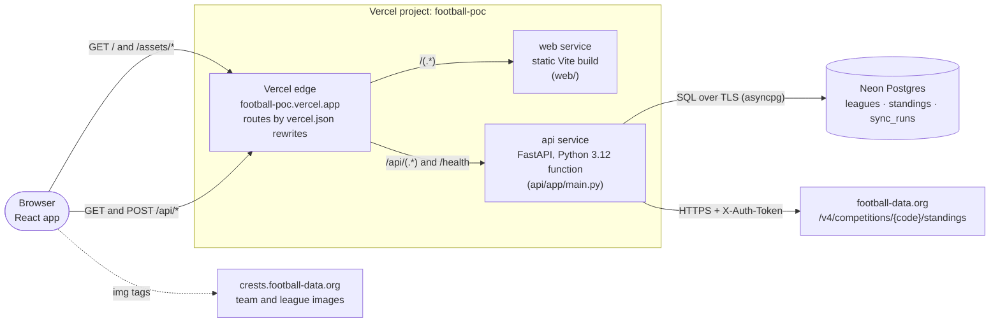
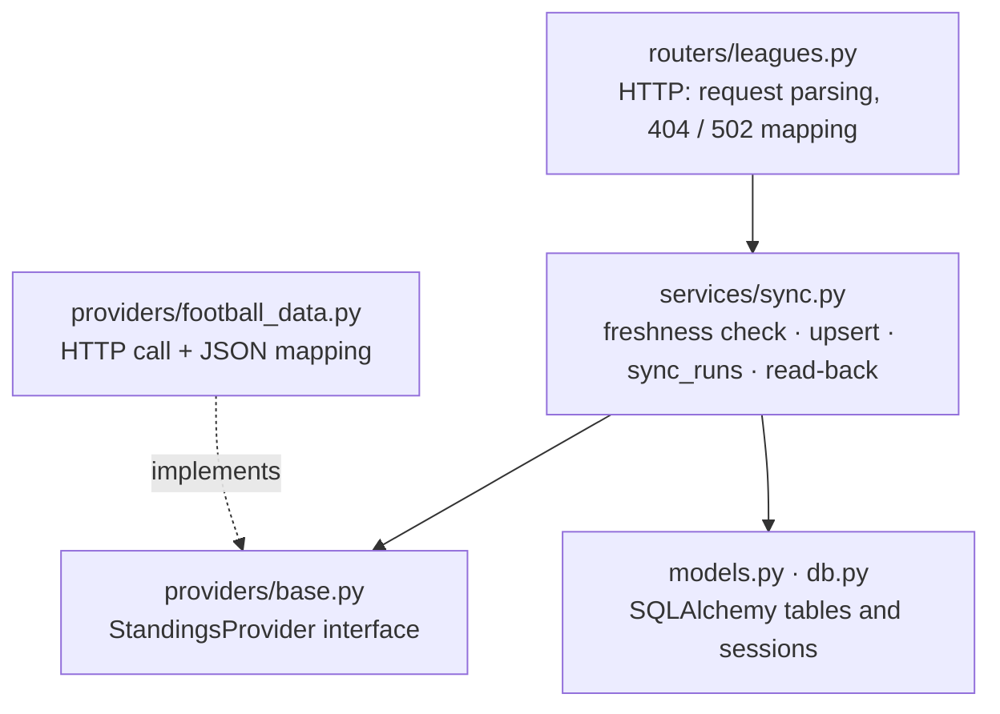
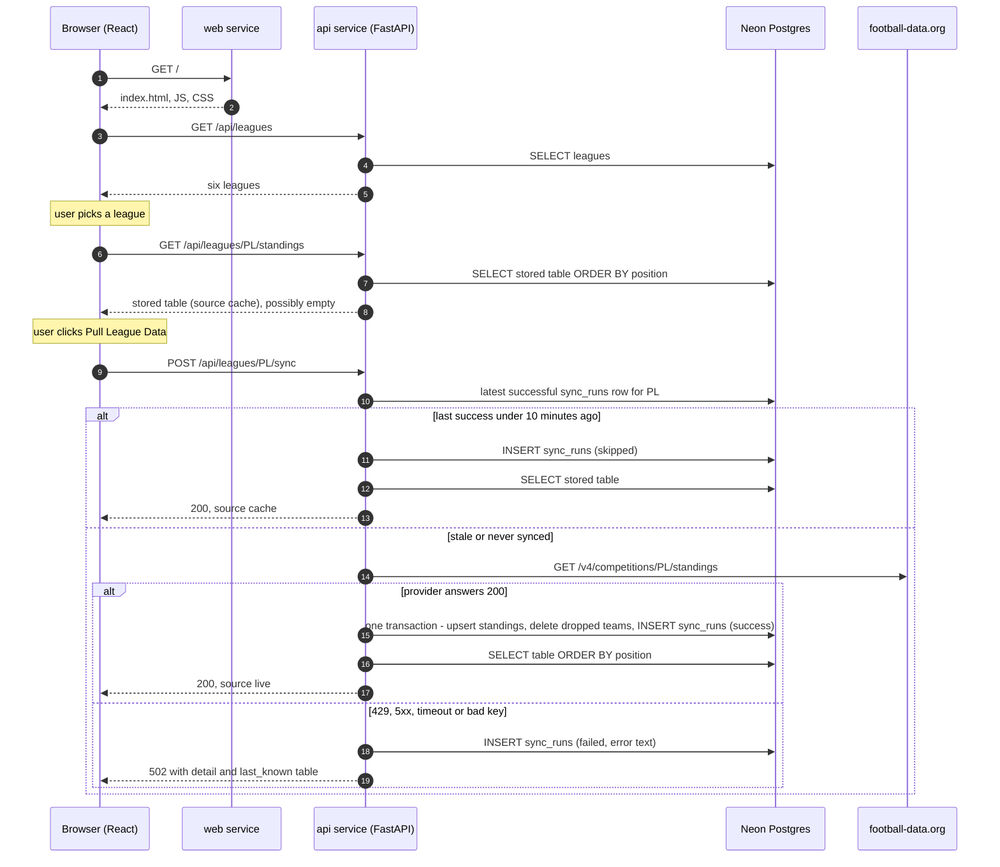
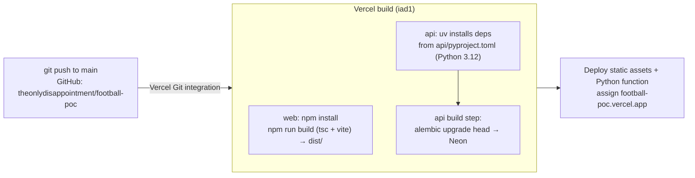

# Architecture

Football League Table POC: a web page where you pick a league and click **Pull League Data**. A
FastAPI backend fetches the current standings from football-data.org, stores them in Postgres, and
returns the stored rows. The React page renders them.

This document covers what exists today (resources), how the pieces connect (component diagram),
where the UI gets each piece of data (data sources and request flow), and how code reaches
production (deployment). For a code-level walkthrough of a single click, see
[HOW_IT_WORKS.md](HOW_IT_WORKS.md).

---

## 1. Resources in place

| Resource | Where | Identifier | Purpose |
| --- | --- | --- | --- |
| Source code | GitHub | `theonlydisappointment/football-poc`, branch `main` | Single repo for frontend, backend, migrations, Compose setup |
| Hosting | Vercel, team **alakehinde-7172's projects** (Hobby plan) | Project `football-poc` (`prj_C2vbqvYyQVRzm3JRmnDFquUNy1Vk`), team `team_60CrpogWCBvA23cP66TDEdDA` | Builds and serves both services; Git-connected |
| Production URL | Vercel | `https://football-poc.vercel.app`. Aliases: `football-poc-alakehinde-7172s-projects.vercel.app`, `football-poc-git-main-alakehinde-7172s-projects.vercel.app` | Public entry point (behind Vercel Authentication, see §5.5) |
| Database | Neon Postgres, added through the Vercel Marketplace | Vercel store `store_ywVe7xv01TxuQrWk` | Tables `leagues`, `standings`, `sync_runs`, `alembic_version` |
| Standings data | football-data.org v4 (free tier) | `GET /v4/competitions/{code}/standings` | Source of truth for league tables. Limit: 10 requests/minute |
| Images | `crests.football-data.org` | `…/{teamId}.png`, `…/{code}.png` | Team crests and league emblems, loaded directly by the browser |
| Secret | Vercel environment variable | `FOOTBALL_DATA_API_KEY` (Sensitive, Production only) | Sent as the `X-Auth-Token` header. Only the API service reads it |
| Local stack | Docker Compose (developer machines) | `db`, `api`, `web` services | Development and tests. Not used in production |

---

## 2. Component diagram



**How the pieces divide the work:**

| Component | Code | Responsibility |
| --- | --- | --- |
| **web** service | `web/` (React 19, Vite, TypeScript) | One screen: league buttons, Pull button, standings table. Talks only to `/api/*` on its own origin. |
| **api** service | `api/app/` (FastAPI, SQLAlchemy async, httpx) | Endpoints, freshness check, provider call, transactional upsert, read-back. Owns the API key. |
| Routing | `vercel.json` | `/api/(.*)` and `/health` go to `api`. Everything else goes to `web`. |
| Provider adapter | `api/app/providers/` | `StandingsProvider` interface. `FootballDataProvider` is the only code that knows football-data.org. |
| Database | Neon Postgres | Stores the leagues, the latest table per league and season, and an audit row for every sync. |
| Migrations | `api/alembic/` | Schema and seed data. Applied during every Vercel build (§5). |

Inside the API, each layer only knows the one below it:



---

## 3. Where the UI loads data from

The browser never calls football-data.org's API, and it never sees the API key. Everything except
images comes from our own domain.

| What the user sees | Request from the browser | Served by | Data comes from |
| --- | --- | --- | --- |
| Page, JS, CSS | `GET /`, `GET /assets/*` | **web** service (Vercel CDN) | Build output `web/dist/` |
| League buttons | `GET /api/leagues` | **api** | Neon: `leagues` table (seeded by migration `0001`) |
| Table shown on league switch | `GET /api/leagues/{code}/standings` | **api** | Neon: `standings` for the latest stored season. Never calls the provider |
| Table after **Pull League Data** | `POST /api/leagues/{code}/sync` | **api** | Neon if the last successful sync was under 10 minutes ago ("cache"). Otherwise football-data.org, then written to Neon and read back ("live") |
| "Last updated HH:MM · live/cache" | Same response | **api** | `fetched_at` and `source` fields |
| Team crests and league emblems | `` | football-data.org's image host | URLs stored in `standings.team_crest` and `leagues.emblem_url` |

**How the frontend picks the API address** (`web/src/api.ts`):

```ts
// Empty = same origin (Vercel serves the API under /api). Docker Compose sets http://localhost:8000.
export const API_URL = (import.meta.env.VITE_API_URL ?? "").replace(/\/+$/, "");
```

- On Vercel, `VITE_API_URL` is not set, so requests go to `/api/...` on the same domain. No CORS is
  involved.
- Locally under Docker Compose, it is `http://localhost:8000`, and the API's CORS settings allow the
  Vite origin.
- With plain `npm run dev`, the Vite dev server forwards `/api` and `/health` to
  `localhost:8000`.

---

## 4. Request flow



Every `/api/*` request passes through the Vercel edge and the `vercel.json` rewrite. The diagram
leaves that hop out to stay readable.

**Response shape** for `/sync` and `/standings`:

```json
{
  "league": { "code": "PL", "name": "Premier League", "country": "England", "emblem_url": "…" },
  "season": "2026-2027",
  "fetched_at": "2026-11-11T12:10:37Z",
  "source": "live",
  "rows": [ { "position": 1, "team_id": "…", "team_name": "…", "played": "…", "won": "…", "draw": "…",
              "lost": "…", "goals_for": "…", "goals_against": "…", "goal_difference": "…",
              "points": "…", "form": "W,D,L,W,W" } ]
}
```

On a provider failure, `/sync` returns **502** `{"detail": "...", "last_known": <same shape or null>}`.
The UI shows the red banner and keeps the last table on screen.

---

## 5. How it's deployed

### 5.1 Pipeline



1. **Trigger.** A push to `main` creates a **Production** deployment. Pushes to other branches and
   pull requests create **Preview** deployments with their own URLs.
2. **Detect services.** Vercel reads `vercel.json`, finds the two services, and builds each from
   its own root (`web/`, `api/`). The project's framework setting is "Services".
3. **Build web.** `npm install`, then `npm run build`: a TypeScript check, then `vite build` into
   `dist/`.
4. **Build api.** Python 3.12 (from `api/.python-version`). Dependencies are installed with uv
   from `api/pyproject.toml`, and the entrypoint is `app.main:app`.
5. **Migrate.** The build command in `api/pyproject.toml` runs against the database in the
   environment variables:

   ```toml
   [tool.vercel.scripts]
   build = "alembic upgrade head"
   ```

   If the migration fails, the whole deployment fails and the previous version stays live.
6. **Go live.** Outputs are uploaded and the production domains move to the new deployment. A
   typical build takes 10–15 seconds.

### 5.2 Configuration files

| File | What it controls |
| --- | --- |
| `vercel.json` | The two services and the routing rewrites |
| `api/pyproject.toml` | API dependencies (Vercel installs from here), Vercel entrypoint, build command |
| `api/requirements.txt` | The same dependencies for the Docker image. `tests/test_config.py` fails if the two lists differ |
| `api/.python-version` | Pins Python 3.12 on Vercel |
| `web/package.json` | Frontend dependencies and the `build` script |

### 5.3 Environment variables (Vercel project)

| Variable | Set by | Targets | Used by |
| --- | --- | --- | --- |
| `FOOTBALL_DATA_API_KEY` | Manually, marked Sensitive | Production | api: the `X-Auth-Token` header. Surrounding whitespace is trimmed |
| `DATABASE_URL_UNPOOLED` | Neon integration | Preview, Production | api: **preferred** DB connection (direct, not through PgBouncer) |
| `DATABASE_URL` | Neon integration | Preview, Production | api: fallback when the unpooled URL is missing |
| `PG*`, `POSTGRES_*`, `NEON_*`, `VITE_NEON_AUTH_URL` | Neon integration | Preview, Production | Not used by this app |

The API converts Neon's `postgres://…?sslmode=require&channel_binding=require` URLs into the
format the async driver expects (`app/config.py → to_asyncpg_url`).

### 5.4 Runtime behaviour on Vercel

- **Function instances.** The FastAPI app runs as a Vercel Python function. Each instance runs the
  app's startup code once, creating one shared HTTP client for football-data.org and a small
  database connection pool.
- **Regions.** Builds run in `iad1` (Washington, D.C.). Runtime logs record a region on each request
  (`iad1`, `fra1` and `cdg1` have appeared so far).
- **Logs.** Each sync logs one line, e.g. `sync league=PL status=success rows=20 season=2026-2027`
  or `status=skipped` or `status=failed error=…`. These are in Vercel's runtime logs, and the same
  facts are in the `sync_runs` table.
- **Not exposed.** `/docs` and `/openapi.json` are not routed to the API on Vercel. They work
  locally at `http://localhost:8000/docs`.

### 5.5 Access and protection

- The project has **Vercel Authentication** on for all deployments except custom domains, and that
  includes `football-poc.vercel.app`. Visitors must sign in to a Vercel account with access to the
  team.
- To make the site public, turn it off under Settings → Deployment Protection. The tradeoff:
  anyone could then trigger syncs, which spend football-data.org quota. The 10-minute cache limits
  this to about six provider calls per league per hour.

### 5.6 Rollback

In Vercel → Deployments, pick an earlier production deployment and choose **Instant Rollback** (or
Promote). This rolls back **code only**: database migrations are not reversed. The current schema
is a single migration, so this is safe today.

---

## 6. Environments at a glance

| | Local (Docker Compose) | Vercel Production | Vercel Preview |
| --- | --- | --- | --- |
| Triggered by | `docker compose up --build` | Push to `main` | Push to any other branch, or a PR |
| URL | Web: `localhost:5173`. API: `localhost:8000` | `football-poc.vercel.app` | A URL per deployment, on `*.vercel.app` |
| Browser → API | Cross-origin to `localhost:8000` (CORS) | Same origin, `/api` | Same origin, `/api` |
| Database | `postgres:16-alpine` container | Neon | Neon, using the **same variables as Production** (see §7) |
| Migrations run | When the API container starts | Vercel build step | Vercel build step |
| football-data.org key | `.env` (git-ignored) | Vercel env var (Sensitive) | **Not set**, so syncs return 502 |
| Tests | `docker compose run --rm api pytest` (separate `football_test` DB) | n/a | n/a |

---

## 7. Known risks and follow-ups

| Risk | Why it matters | Suggested fix |
| --- | --- | --- |
| Preview deployments share the production database | The Neon variables target both Preview and Production, so a branch's build runs `alembic upgrade head` against production data | Turn on Neon's preview branching in the integration, or give Preview its own database |
| No API key in Preview | Syncs on preview URLs fail with 502 | Add `FOOTBALL_DATA_API_KEY` to the Preview target if previews should pull live data |
| Concurrent clicks on a stale league | Two users at the same moment can both call the provider | Serialise with `pg_advisory_xact_lock(league_id)` in `services/sync.py` |
| Free-tier rate limit (10 requests/minute) | Several stale leagues pulled quickly can return 429 | The cache already helps. Scheduled syncs (Vercel Cron) would remove user-triggered calls |
| Database far from the function | Each query adds a network round trip if Neon and the serving region are on different continents | Keep Neon and the function region close together. Check Vercel's function region setting |
| Images hotlinked from football-data.org | If their image host is slow or down, crests are missing. The UI hides broken images | Cache images in Vercel Blob if that becomes a problem |
