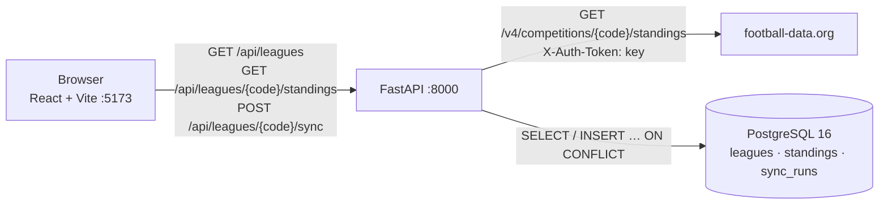

# How it works

This document walks a newcomer through the codebase. Snippets are copied from the real files.

---

## 1. Big picture



- The **browser** only talks to our API. It never sees the football-data.org key.
- **FastAPI** decides whether to call the provider. It writes the result to Postgres, then reads
  the table back from Postgres.
- **Postgres** is the source of truth for what the page shows. A table that was fetched seconds
  ago is still read back from the DB, never passed straight through from the provider.

Inside the API, code is layered so each layer knows only about the one below:

```
routers/leagues.py      HTTP: parse request, map exceptions to 404/502
        │
services/sync.py        Business logic: freshness, upsert, sync_runs, read-back
        │                         │
providers/base.py  ◄──  providers/football_data.py     (the only file that knows football-data.org)
        │
models.py / db.py       SQLAlchemy tables and sessions
```

---

## 2. One click, traced

The user has picked **Premier League** and clicks **Pull League Data**.

**Before the click: picking a league**

1. `web/src/components/LeaguePicker.tsx`, the `onClick` handler, calls `onSelect("PL")`. That is
   `setSelected` in `App.tsx`.
2. `web/src/App.tsx`, the `useEffect` that depends on `[selected]`, calls
   `api.getStandings("PL")`. That goes to `GET /api/leagues/PL/standings`, which
   `routers/leagues.py → standings()` serves through `services/sync.py → read_table()`. The
   screen shows whatever Postgres already has, so it isn't blank while you decide whether to pull.

**The click**

3. **`web/src/App.tsx` → `pullLeagueData()`** sets `syncing = true`. The button disables and
   shows the spinner. It then calls:

   ```ts
   const data = await api.syncLeague(code);
   ```

4. **`web/src/api.ts` → `api.syncLeague()` → `request()`** sends
   `fetch(`${API_URL}/api/leagues/PL/sync`, { method: "POST" })`. `API_URL` comes from
   `VITE_API_URL`.

5. **`api/app/main.py`**: the request passes through `CORSMiddleware`, which allows the Vite
   origin, and FastAPI routes it to the router.

6. **`api/app/routers/leagues.py` → `sync()`**. FastAPI first resolves the dependencies:
   - `db.get_session()` opens an `AsyncSession` for this request.
   - `get_provider()` returns `request.app.state.provider`. That is the single
     `FootballDataProvider` built once in `main.lifespan()`, holding a pooled `httpx.AsyncClient`.
   - `config.get_settings()` supplies `cache_ttl_seconds = 600`.

   It then calls the service and maps exceptions to HTTP:

   ```python
   try:
       return await sync_league(session, provider, code, cache_ttl_seconds=settings.cache_ttl_seconds)
   except LeagueNotFound:
       raise HTTPException(status_code=404, detail=f"Unknown league code '{code}'") from None
   except SyncFailed as exc:
       body = SyncErrorResponse(detail=exc.detail, last_known=exc.last_known)
       return JSONResponse(status_code=502, content=body.model_dump(mode="json"))
   ```

7. **`api/app/services/sync.py` → `sync_league()`** runs the flow:
   - `get_league(session, "PL")` loads the `leagues` row, or raises `LeagueNotFound`, which
     becomes a 404.
   - `has_fresh_success()` asks Postgres when the last successful sync finished:

     ```python
     last_success = await session.scalar(
         select(func.max(SyncRun.finished_at)).where(
             SyncRun.league_id == league_id, SyncRun.status == "success"
         )
     )
     return last_success is not None and utcnow() - last_success < timedelta(seconds=ttl_seconds)
     ```

     If that was under 10 minutes ago, it records a `skipped` sync run and returns
     `read_table(..., source="cache")`. No provider call happens. That is the whole cache.
   - Otherwise it commits, which ends the read transaction so no DB connection sits idle during
     the HTTP call, and calls `provider.fetch_standings("PL")`.

8. **`api/app/providers/football_data.py` → `FootballDataProvider.fetch_standings()`** does the
   HTTP call. `X-Auth-Token` is set once on the client in `__init__`:

   ```python
   response = await self._client.get(f"/competitions/{code}/standings")
   ```

   Then it translates failures into one exception type, `ProviderError`:
   - a timeout becomes "timed out"
   - a 429 becomes "rate limit hit"
   - a 401 or 403 becomes "rejected the request"
   - any other status of 400 or above becomes "returned HTTP n"

   On success it calls **`map_standings(response.json())`**, a pure function. It picks the
   `standings[]` entry where `type == "TOTAL"`, converts each camelCase table row into a
   `TeamStanding`, and builds the season label:

   ```python
   def season_label(season: dict[str, Any]) -> str:
       start = date.fromisoformat(season["startDate"]).year
       end = date.fromisoformat(season["endDate"]).year
       return str(start) if start == end else f"{start}-{end}"
   ```

   It returns a `StandingsResult(competition_code, season, rows, emblem_url)`, defined in
   **`providers/base.py`**.

9. **Back in `sync_league()`**, `upsert_standings()` writes every row in one statement (see
   [Database](#4-database)). It also deletes teams the provider no longer lists for that season,
   and refreshes the league's emblem URL. Then it adds the audit row and commits once:

   ```python
   rows_written = await upsert_standings(session, league, result)
   session.add(
       SyncRun(league_id=league.id, status="success", rows_written=rows_written,
               started_at=started_at, finished_at=utcnow())
   )
   await session.commit()
   ```

   The upsert, the delete and the `success` row are in the same transaction. Either all of them
   land or none do (`tests/test_sync.py::test_write_failure_rolls_back_everything`).

10. **`services/sync.py` → `read_table(..., source="live")`** reads the table back from
    Postgres with `ORDER BY position`. It wraps the rows in a `StandingsResponse`, defined in
    **`app/schemas.py`**. FastAPI serialises that through the route's `response_model`.

11. **`web/src/App.tsx`** receives the JSON. If the user is still on that league
    (`selectedRef.current === code`), it calls `setTable(data)`. **`StandingsTable.tsx`** renders
    the rows. The status line shows `Last updated 14:32 · live`, from `formatUpdated(fetched_at)`
    and `source`.

**If the provider fails** (429, 5xx, timeout, missing key):
- Step 7 catches the `ProviderError` and records a `failed` sync run with the error text.
- It raises `SyncFailed(detail, last_known)`. `last_known` is the stored table, or `None` if there
  isn't one.
- The router returns **502** `{detail, last_known}`.
- `api.ts` throws `ApiError` carrying `lastKnown`.
- `App.tsx` shows the red banner and keeps a table on screen: `lastKnown` if present, otherwise
  the table already showing.

---

## 3. Each file's job

| File | Job |
| --- | --- |
| `docker-compose.yml` | Three services: `db` (Postgres 16 with a healthcheck), `api` (waits for `db` to be healthy), `web` (waits for `api`). Only `api` receives the API key. |
| `.env.example` | Template for the three settings you fill in. `.env` itself is git-ignored. |
| `api/Dockerfile` | Python 3.12 slim image with runtime and test deps. Runs as a non-root user. `CMD` runs `alembic upgrade head` and then `uvicorn`. |
| `api/requirements*.txt` | Pinned runtime deps, and test deps (`pytest`, `pytest-asyncio`). |
| `api/pyproject.toml` | Project metadata and pytest config (`asyncio_mode = "auto"`). |
| `api/alembic.ini`, `alembic/env.py` | Alembic config. `env.py` reads `DATABASE_URL` from `app.config` and runs migrations over asyncpg. |
| `api/alembic/versions/0001_initial.py` | Creates the three tables and seeds the six leagues. |
| `api/app/main.py` | Builds the FastAPI app: lifespan (creates and closes the provider and DB engine), CORS, router, `/health`. |
| `api/app/config.py` | `Settings` (pydantic-settings) read from env. The key is a `SecretStr`, so it never shows up in reprs or logs. |
| `api/app/db.py` | The async engine, `SessionLocal`, and the `get_session` dependency. |
| `api/app/models.py` | SQLAlchemy 2.0 typed models: `League`, `Standing`, `SyncRun`. |
| `api/app/schemas.py` | Pydantic response models: the JSON contract with the frontend. |
| `api/app/providers/base.py` | The provider contract: `StandingsProvider`, `StandingsResult`, `TeamStanding`, `ProviderError`. |
| `api/app/providers/football_data.py` | The football-data.org adapter: the HTTP call, error translation, and `map_standings()`. |
| `api/app/services/sync.py` | The sync flow: freshness check, upsert, `sync_runs`, read-back. Knows nothing about HTTP or football-data.org. |
| `api/app/routers/leagues.py` | The four `/api/leagues…` endpoints. Converts `LeagueNotFound` to 404 and `SyncFailed` to 502. |
| `api/tests/conftest.py` | Creates and migrates `football_test`, truncates tables between tests, provides `StubProvider` and an in-process HTTP client. |
| `api/tests/test_mapper.py` | `map_standings` against the JSON fixture, plus the adapter's HTTP error handling via `httpx.MockTransport`. |
| `api/tests/test_sync.py` | The sync service against real Postgres: cache hit and miss, upsert-in-place, rollback, failure paths. |
| `api/tests/test_api.py` | HTTP contract: status codes, JSON shapes, 404, 502 with `last_known`, CORS. |
| `api/tests/fixtures/pl_standings.json` | A football-data.org-shaped standings payload. Synthetic: see `fixtures/README.md`. |
| `web/Dockerfile` | Node 22 image. `npm ci`, then the Vite dev server on 5173. |
| `web/package.json`, `vite.config.ts`, `tsconfig.json`, `index.html` | React 19, Vite 8, strict TypeScript. The dev server listens on `0.0.0.0:5173`. |
| `web/src/main.tsx` | Mounts `<App />` and imports the stylesheet. |
| `web/src/App.tsx` | The single screen: state (leagues, selected, table, loading, syncing, error), data loading, the four UI states. |
| `web/src/api.ts` | Typed `fetch` wrapper and response types. Turns error responses into `ApiError` (with `lastKnown` on a 502). |
| `web/src/components/LeaguePicker.tsx` | Row of toggle buttons (`aria-pressed`), one per league. |
| `web/src/components/StandingsTable.tsx` | Semantic table. Pos and Club stay pinned while the rest scrolls sideways on phones. Also the form pills. |
| `web/src/styles.css` | Plain CSS: design tokens, automatic dark mode, a responsive table using a container query. |

---

## 4. Database

| Table | Stores |
| --- | --- |
| `leagues` | The leagues we support: `code` (`PL`, `PD`, `BL1`, `SA`, `FL1`, `CL`), `name`, `country`, `emblem_url`. Seeded by the first migration. |
| `standings` | One row per **(league, season, team)**: position, P/W/D/L, goals, GD, points, form, and `fetched_at` (when this row was last written). |
| `sync_runs` | One row per Pull click: `success`, `skipped` or `failed`, plus `rows_written`, `error`, and start and finish times. This is the audit log, and it drives the cache. |

**Why `UNIQUE (league_id, season, team_id)`?** A team appears once in a league's table per season.
The constraint makes that a database guarantee rather than a hope. It also lets
`INSERT … ON CONFLICT` know which existing row a new row collides with. Including `season` keeps
last season's table intact when the new season starts.

**How the upsert works.** `upsert_standings()` builds one multi-row statement:

```python
stmt = pg_insert(Standing).values(values)
stmt = stmt.on_conflict_do_update(
    index_elements=["league_id", "season", "team_id"],
    set_={col: stmt.excluded[col] for col in UPDATABLE_COLUMNS} | {"fetched_at": func.now()},
)
```

which Postgres receives as:

```sql
INSERT INTO standings (league_id, season, team_id, team_name, team_crest, position, played, won, draw,
                       lost, goals_for, goals_against, goal_difference, points, form)
VALUES (1, '2026-2027', 57, 'Arsenal', ...), (1, '2026-2027', 65, 'Man City', ...), ...  -- all rows
ON CONFLICT (league_id, season, team_id) DO UPDATE SET
    team_name = excluded.team_name, position = excluded.position, points = excluded.points, ...,
    fetched_at = now();
```

- First pull of the season: no conflicts, so every row is inserted.
- Later pulls: every row conflicts, so every row is updated in place and keeps its `id`
  (`test_upsert_updates_rows_in_place`).
- After the upsert, a `DELETE … WHERE team_id NOT IN (…)` removes any team the provider stopped
  listing. The stored table then exactly mirrors the provider's.

**Sample queries:**

```bash
docker compose exec db psql -U football
```

```sql
-- The current Premier League table as stored
SELECT s.position, s.team_name, s.played, s.won, s.draw, s.lost, s.goal_difference, s.points, s.form, s.fetched_at
FROM standings s JOIN leagues l ON l.id = s.league_id
WHERE l.code = 'PL' AND s.season = '2026-2027'
ORDER BY s.position;

-- What each click did
SELECT r.id, l.code, r.status, r.rows_written, r.error, r.finished_at
FROM sync_runs r JOIN leagues l ON l.id = r.league_id
ORDER BY r.id DESC LIMIT 10;
```

---

## 5. Design decisions

**The backend owns the API key.**
- Anything in frontend code ships to every visitor's browser. Vite inlines `VITE_*` variables into
  the bundle, so a key there is public.
- The key lives only in the `api` container's environment. It is held as a `SecretStr` and sent
  only as the `X-Auth-Token` header.
- Error messages are written by hand, never copied from request objects, and a test checks that
  they never contain the key (`test_error_messages_never_contain_the_key`).
- `docker-compose.yml` passes the key to `api` only.

**Why a 10-minute cache?**
- The free tier allows **10 requests per minute**, and league tables only change when matches
  finish.
- Re-fetching on every click would burn quota and make a 429 likely when someone clicks around
  quickly. Ten minutes keeps data fresh enough for a live matchday.
- The cache is just "was there a successful sync recently?", answered from `sync_runs`. No extra
  infrastructure is needed.
- Failed and skipped runs don't count as fresh, so a failure never blocks a retry. The window is
  configurable with `CACHE_TTL_SECONDS`.

**Why the adapter interface?**
- `services/sync.py` only knows `StandingsProvider.fetch_standings(code) -> StandingsResult` and
  `ProviderError`.
- Everything specific to football-data.org lives in one file: its URL, its auth header, its
  camelCase JSON, its `TOTAL`/`HOME`/`AWAY` split, its season dates.
- Adding OpenLigaDB or TheSportsDB means writing one new class. The sync logic, the database and
  the frontend don't change.
- The same seam makes testing easy: `StubProvider` in `conftest.py` is about ten lines.

**Why `sync_runs` exists.**
- **It drives the cache.** "Latest success under 10 minutes old" is a query on this table.
- **It is an audit log.** You can see when data was pulled, how many rows were written, and the
  exact error when it failed (`SELECT * FROM sync_runs WHERE status = 'failed'`).
- **It is the hook for the future.** Scheduled syncs, alerting on repeated failures, and per-user
  rate limits can all build on it.

**Smaller choices:**
- **The API returns what Postgres holds**, not the provider response. Live and cached responses
  therefore always have the same shape and ordering.
- **No transaction is open during the HTTP call** (the `session.commit()` before
  `fetch_standings`), so a slow provider can't tie up database connections.
- **Team names use `shortName`** ("Man City"), falling back to `name`, so the table fits on a
  phone.

**Known limits** (fine for a POC):
- Two people clicking the same stale league at the same instant can both reach the provider. A
  `pg_advisory_xact_lock(league_id)` would serialise them.
- Tournaments with several `TOTAL` tables (old Champions League group stages) use only the first.
  The current 36-team league phase is a single table, so this doesn't affect it today.
- `web` runs the Vite dev server. For production, run `vite build` and serve `dist/` statically.

---

## 6. Run it

**Prerequisites:** Docker with Compose v2, and a free football-data.org key.

```bash
cp .env.example .env          # then set FOOTBALL_DATA_API_KEY
docker compose up --build
```

- Web: http://localhost:5173
- API: http://localhost:8000 (interactive docs at http://localhost:8000/docs)
- Postgres: `docker compose exec db psql -U football`

| Variable | Default | Notes |
| --- | --- | --- |
| `FOOTBALL_DATA_API_KEY` | empty | Required for live data. Read only by `api`. |
| `DATABASE_URL` | `postgresql+asyncpg://football:football@db:5432/football` | `db` is the compose service name |
| `VITE_API_URL` | `http://localhost:8000` | Read by the Vite dev server |
| `CORS_ORIGINS` | `http://localhost:5173,http://127.0.0.1:5173` | Comma-separated |
| `CACHE_TTL_SECONDS` | `600` | Not in `.env.example`. Add it to the `api` environment in `docker-compose.yml` to change it. |

**Tests:**

```bash
docker compose run --rm api pytest
```

The tests use a separate `football_test` database on the same server. `conftest.py` refuses to
run against any database whose name doesn't end in `_test`. It runs the real Alembic migrations
(`downgrade base`, then `upgrade head`) at the start of every session.

**Smoke test with curl:**

```bash
curl -s localhost:8000/health
curl -s localhost:8000/api/leagues
curl -s -X POST localhost:8000/api/leagues/PL/sync | head -c 400   # source: "live"
curl -s -X POST localhost:8000/api/leagues/PL/sync | head -c 400   # within 10 min: source: "cache"
```

---

## 7. Extend it

**Add a league.**
- football-data.org's free tier has 12 competitions. Besides the six seeded here, you can add
  `ELC` (Championship), `DED` (Eredivisie), `PPL` (Primeira Liga) and `BSA` (Brasileirão).
- Create a new migration, `alembic revision -m "add eredivisie"`, and insert a row:

  ```python
  def upgrade() -> None:
      op.execute("INSERT INTO leagues (code, name, country) VALUES ('DED', 'Eredivisie', 'Netherlands')")

  def downgrade() -> None:
      op.execute("DELETE FROM leagues WHERE code = 'DED'")
  ```

- The frontend picks it up from `GET /api/leagues` automatically.
- Calendar-year leagues such as `BSA` get a season label like `"2026"`, because `season_label()`
  already handles that case.

**Add a second provider (e.g. OpenLigaDB).**
1. Create `app/providers/openligadb.py` with
   `class OpenLigaDbProvider(StandingsProvider)`. Implement `fetch_standings(code)`: map our code
   to theirs (`BL1` → `bl1` plus a season year), call their table endpoint, return a
   `StandingsResult`, and raise `ProviderError` on failure.
2. Pick the provider in `main.lifespan()` from a new setting, e.g. `STANDINGS_PROVIDER=openligadb`.
3. **Watch out for team IDs.** They are provider-specific. If two providers can write the same
   league, add a `provider` column to `standings` and include it in the unique constraint, or map
   their IDs to yours.
4. Add a fixture and a `test_<provider>_mapper.py`. `test_sync.py` needs no changes.

**Add scheduled syncs.**
- The flow already exists: call `sync_league()` for each league. The simplest version is a small
  module run on a schedule (a `worker` service in compose, or a cron job):

  ```python
  # app/jobs/sync_all.py
  async def main() -> None:
      async with SessionLocal() as session:
          for code in ["PL", "PD", "BL1", "SA", "FL1", "CL"]:
              try:
                  await sync_league(session, provider, code, cache_ttl_seconds=0)
              except SyncFailed:
                  pass  # already recorded in sync_runs
              await asyncio.sleep(7)  # stay under 10 req/min
  ```

- Once syncs run on a schedule, the frontend could use `GET /standings` only and drop the button.
- Add the advisory lock mentioned above, so a scheduled sync and a click can't overlap.
- Alert when `sync_runs` shows repeated failures.

**Add login later.**
- Keep the read endpoints public.
- Protect `POST /sync` with a FastAPI dependency, e.g. `user: User = Depends(current_user)`, that
  validates a session cookie or a JWT from your identity provider.
- Add a `users` table and a nullable `sync_runs.user_id`, so the audit log records who pulled.
- For cookie auth, set `allow_credentials=True` in `CORSMiddleware` and send
  `credentials: "include"` from `api.ts`.
- Per-user rate limits can then be a query on `sync_runs`.
